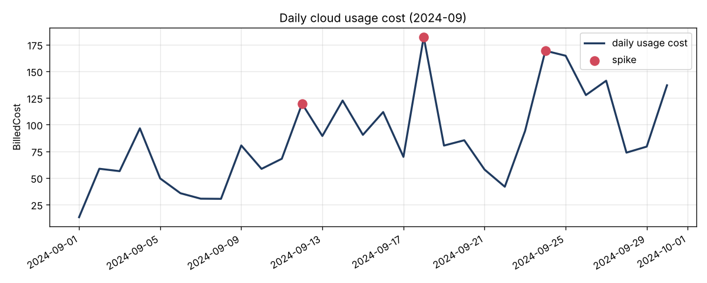

# cloud-cost-analyzer

finds out where a company's cloud money goes, what looks wrong, and what could be saved. works with AWS, Azure, Google Cloud and Oracle bills because it reads the open FOCUS billing format.



## why i made this

cloud bills are huge tables with 100k+ rows per month and nobody really reads them. FinOps teams answer the same questions every month: which team spends what, what is nobody's, where did the cost jump, what could we turn off. i wanted to build a tool that answers those from the raw export and hands the result to people the way they actually work, in excel and power bi.

## what it does

- reads a FOCUS export (.csv or .csv.gz) and cleans it
  - "usage" vs "Usage", costs as text or NULL, duplicate rows, broken dates
  - tags are a JSON string per row and teams spell them differently (`environment` / `env` / `ENV`, `Production` / `prod`), so they get normalised into one column per tag
- breaks the usage cost down by service, team, account, environment, provider and region
- finds the money nobody owns (no team tag) and which accounts it sits in
- finds cost spikes per day and says which service caused the biggest jump
- checks FinOps quick wins:
  - dev/test resources running on weekends
  - compute that is not covered by savings plans / reservations
  - tag keys spelled in different ways
- writes the results as
  - an excel report: summary, recommendations, one sheet per breakdown, charts
  - a clean csv fact table for power bi
  - the chart above

## results on the sample data

100,000 rows of anonymized real billing data from the FinOps Foundation (september 2024, AWS + Azure + Oracle):

| | |
|---|---|
| usage cost | 2,614.37 USD, 91 accounts, 44,603 resources |
| credits | -1,196.45 USD |
| no team tag | 714.03 USD (27% of usage) |
| dev/test cost on weekends | 349.77 USD (21% of all non-prod cost) |
| compute covered by commitments | 0% |
| cost spikes | 3 days, biggest on 18.09. with 182 USD instead of ~90 |
| messy tags | 3 keys with several spellings (`environment` / `env` / `Environment` / `ENV` ...) |

## how it works

```
load.py      read + clean the export, parse tags        -> one clean table
analysis.py  the FinOps questions, plain pandas          -> dict of tables and numbers
report.py    excel / power bi csv / png / console text   -> files in reports/
```

- only `ChargeCategory == Usage` counts as spend of a team. credits and tax are shown separately, otherwise a big credit makes a team look cheap
- default cost is `BilledCost` (what is on the invoice). `--cost EffectiveCost` uses the cost after discounts instead
- a day is a spike if it is more than 2.5 robust standard deviations (median / MAD of the 7 days before) above normal AND at least 25% higher. median instead of mean so one earlier spike doesn't hide the next one
- exports often contain a few stray rows from other months, so by default it analyses the month with the most cost (`--month 2024-09` or `--month all` to change that)

the analysis code never touches files, that's why it can be tested with small fake bills where every number can be checked by hand (`tests/`).

## setup

tested on python 3.12 and 3.13

```sh
python -m venv .venv
.venv\Scripts\activate          # windows
source .venv/bin/activate       # mac / linux
pip install -r requirements.txt
```

## run

```sh
python -m cloud_cost_analyzer                                  # sample data
python -m cloud_cost_analyzer my_export.csv.gz --out reports   # your own FOCUS export
python -m cloud_cost_analyzer --month all --cost EffectiveCost
pytest
```

output in `reports/`:

| file | for |
|---|---|
| `cost_report.xlsx` | people who want the answers |
| `powerbi_costs.csv` | power bi: Get Data -> Text/CSV, one row per day x service x account x team |
| `daily_cost.png` | quick look |

## power bi

`powerbi_costs.csv` is built as a fact table: `Date`, `Provider`, `Service`, `Account`, `Team`, `Environment`, `BilledCost`, `EffectiveCost`, `ListCost`. load it, mark `Date` as a date column and build the visuals on top (cost by team, untagged share, daily trend).

## roadmap

- power bi dashboard file (.pbix) in the repo
- month over month comparison when the export has several months
- budgets per team and alerts when a team goes over
- idle resource detection (resources that cost money every day but are barely used)
- read the exports straight from AWS / Azure storage instead of a downloaded file

## data

sample data from the [FinOps Foundation FOCUS sample data](https://github.com/FinOps-Open-Cost-and-Usage-Spec/FOCUS-Sample-Data), CC BY 4.0, see [data/README.md](data/README.md).

## license

MIT, see [LICENSE](LICENSE).
